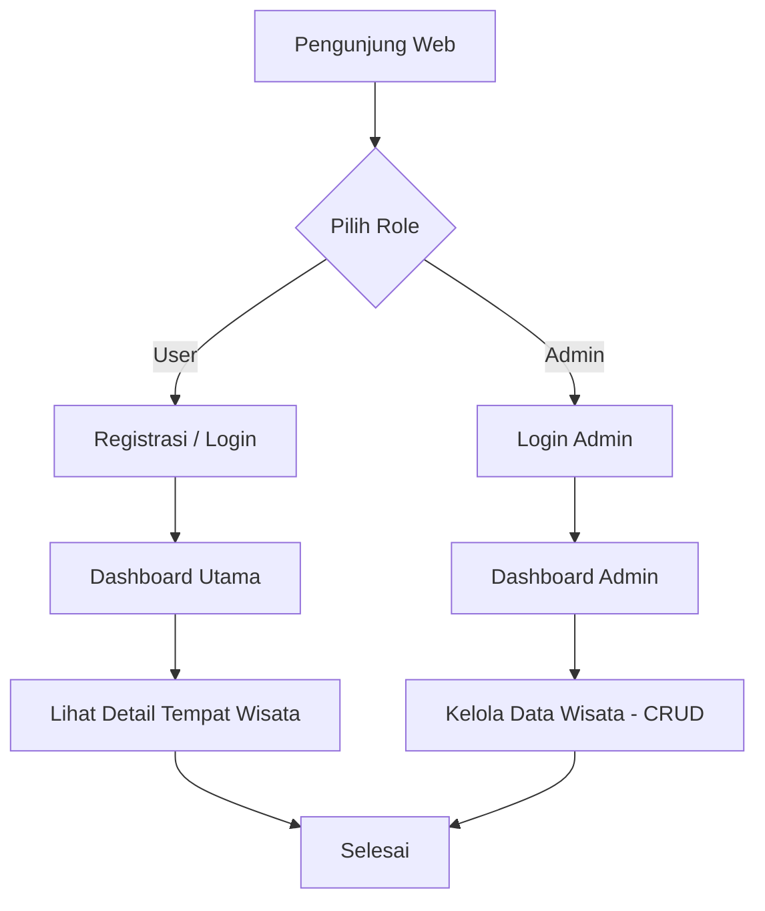

# 🏔️ Lokalify — Platform Informasi Wisata Terkini


**Lokalify** adalah platform berbasis web yang menyediakan informasi *up to date* seputar destinasi tempat wisata lokal. Aplikasi ini memudahkan masyarakat dan pengelana untuk menjelajahi tempat wisata populer, mendapatkan rekomendasi menarik, serta membantu administrator dalam mengelola katalog tempat wisata secara efisien dan cepat.

---

## 🚀 Fitur Utama

### 👤 Bagi Pengguna (User)
* **Register & Login**: Pembuatan akun baru dan autentikasi masuk yang aman.
* **Dashboard Wisata**: Halaman utama berbasis katalog tempat wisata pilihan dan informasi ter-update.
* **Detail Destinasi**: Halaman rinci berisi galeri foto, deskripsi, lokasi, dan informasi operasional tempat wisata.

### 🛡️ Bagi Pengelola (Administrator)
* **Admin Authentication**: Akses khusus halaman manajemen pengelola.
* **Dashboard Monitoring**: Ringkasan data tempat wisata dan statistik umum.
* **Manajemen Wisata (CRUD)**:
  * **Create**: Menambahkan data tempat wisata baru lengkap dengan gambar dan deskripsi.
  * **Read**: Melihat daftar dan status publikasi tempat wisata.
  * **Update**: Mengubah detail data wisata jika ada pembaruan informasi.
  * **Delete**: Menghapus data wisata yang sudah tidak relevan.

---

## 🛠️ Tech Stack & Alat Pengembangan

* **Backend Engine**: [PHP](https://www.php.net/) (Laravel Framework)
* **Database Management System**: [MySQL](https://www.mysql.com/)
* **Frontend**: HTML5, CSS3, JavaScript
* **Development Server**: PHP Artisan Local Engine (`php artisan serve`)

---

## 📂 Struktur Direktori Proyek

```text
lokalify/
├── app/
│   ├── Http/
│   │   ├── Controllers/        # Controller untuk Logika User & Admin
│   │   └── Middleware/         # Validasi Akses & Role User/Admin
│   └── Models/                 # Eloquent Models (Wisata, User, dll.)
├── config/                     # Konfigurasi Aplikasi & Database
├── database/
│   ├── migrations/             # Skema Tabel Database MySQL
│   └── seeders/                # Sample Data Dummy / Admin Default
├── public/
│   ├── css/                    # File Styling CSS
│   ├── js/                     # Scripts Client-side JavaScript
│   └── uploads/                # Berkas Media / Gambar Wisata
├── resources/
│   └── views/                  # Blade Templates (Dashboard, Detail, Form Admin)
├── routes/
│   └── web.php                 # Routing Alur User & Admin
└── .env.example                # Templat Konfigurasi Environment
```

---

## 💻 Panduan Instalasi & Setup Lokal

Ikuti langkah-langkah di bawah ini untuk menjalankan repositori proyek di lingkungan lokal Anda:

### 1. Prerequisites (Prasyarat)
Pastikan perangkat Anda telah terpasang:
* **PHP** (>= 8.1)
* **Composer**
* **MySQL Database Server** (via XAMPP/Laragon/Native)

### 2. Kloning Repositori
```bash
git clone https://github.com/username/lokalify.git
cd lokalify
```

### 3. Instal Dependensi Composer
```bash
composer install
```

### 4. Konfigurasi Environment (`.env`)
Salin berkas contoh `.env.example` menjadi `.env`:
```bash
cp .env.example .env
```

Atur kredensial database pada berkas `.env` sesuai dengan konfigurasi database MySQL lokal Anda:
```env
APP_NAME=Lokalify
APP_ENV=local
APP_KEY=
APP_DEBUG=true
APP_URL=http://127.0.0.1:8000

DB_CONNECTION=mysql
DB_HOST=127.0.0.1
DB_PORT=3306
DB_DATABASE=lokalify_db
DB_USERNAME=root
DB_PASSWORD=
```

### 5. Generate Application Key
```bash
php artisan key:generate
```

### 6. Migrasi & Seeding Database
Jalankan perintah migrasi untuk membuat struktur tabel di MySQL:
```bash
php artisan migrate --seed
```

### 7. Jalankan Server Lokal
```bash
php artisan serve
```
Buka peramban (browser) dan akses alamat: `http://127.0.0.1:8000`

---

## 🔄 Alur Kerja Sistem (Workflow)



---

## 👥 Tim & Pengembang

* **Pengembang**: Despian Ananda(Backend) & Irvan Zaenudin Ilham(Frontend) (Siswa RPL 2026/2027)
* **Proyek**: UKK READY — Monitoring & Assessment System (SMK Budi Bakti)

---

## 📄 Lisensi

Proyek ini dibangun untuk tujuan pemenuhan tugas Uji Kompetensi Keahlian (UKK) Rekayasa Perangkat Lunak.
